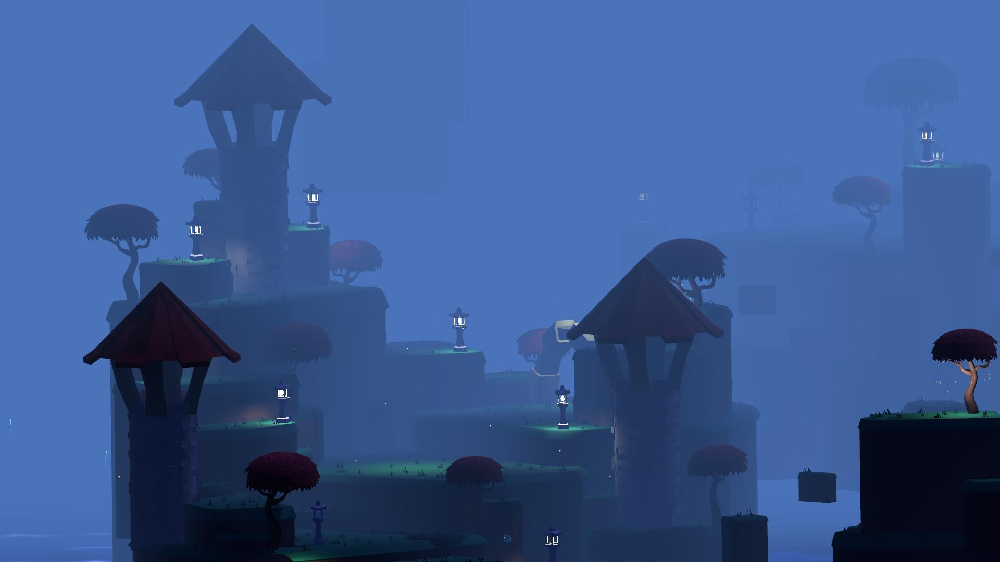
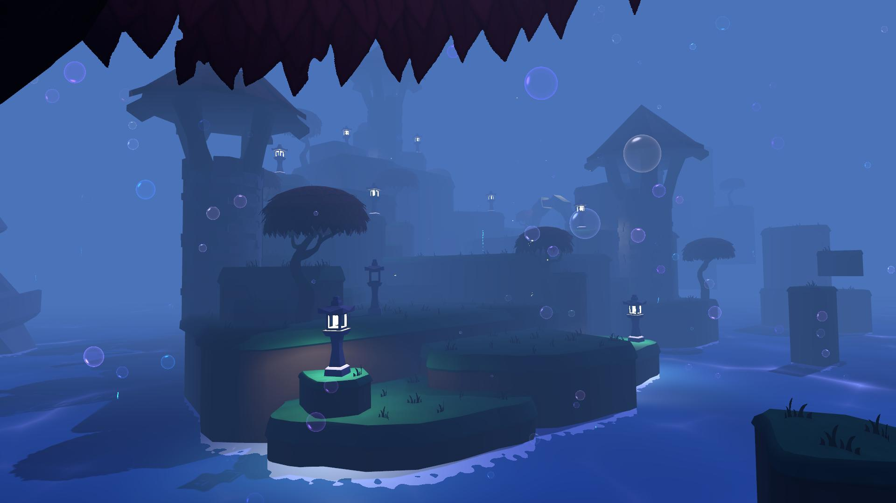
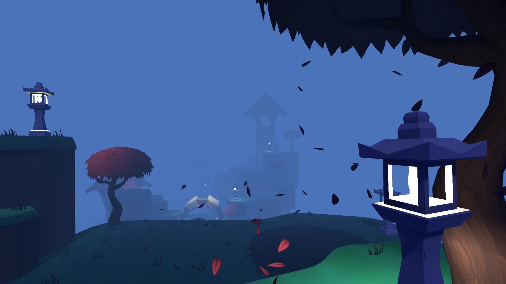
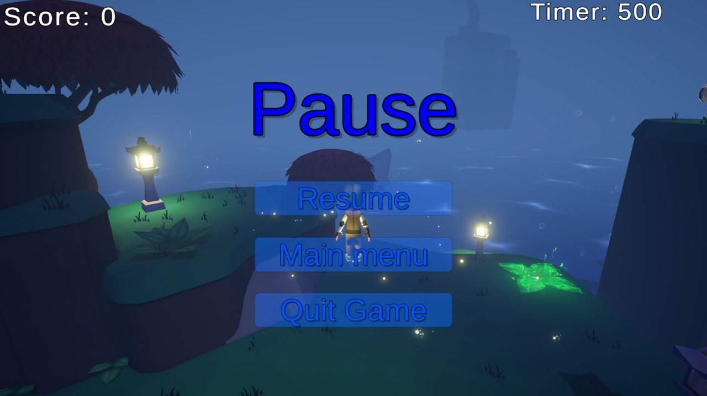

# Parkour Runner 3D

A 3D platformer prototype made in Unity with C#. Run, jump and dash through a foggy low-poly world, collect points and reach the goal before the timer runs out.

Built as a team project.

| | |
| --- | --- |
|  |  |

## Gameplay

- Physics-based character controller: variable jump height, jump buffering and dashing
- Moving platforms, launch pads, gravity fields and death zones
- Pickups, jump boosts, score and a countdown timer
- Checkpoints, so you respawn at the last one you reached
- Start menu, pause menu and background music

## My part

- Start menu, pause menu and sound manager (`Assets/Scenes/StartScene-Mahdi/`)
- Work with the team on the character controller and level mechanics

## Tech

- Unity 2021.3 (URP), C#
- Cinemachine, ProBuilder, Visual Effect Graph
- ShaderLab / HLSL

## Open the project

1. Install **Unity 2021.3.8f1** with Unity Hub.
2. Clone this repo and add the folder in Unity Hub.
3. Open `Assets/Scenes/MainScene.unity` and press Play.

Note: the repo is large (over 1 GB) because it includes all game assets.
